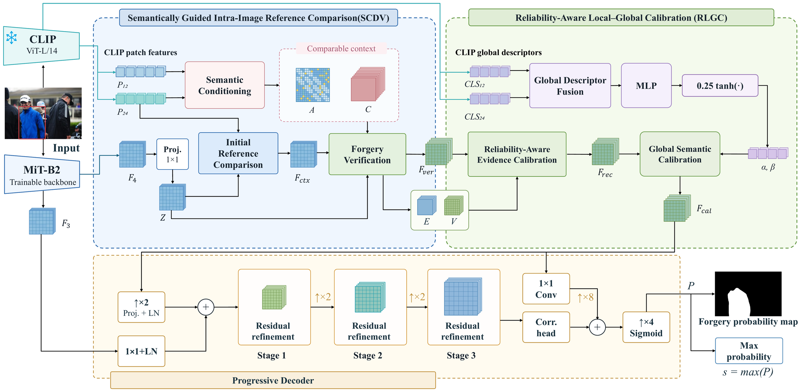
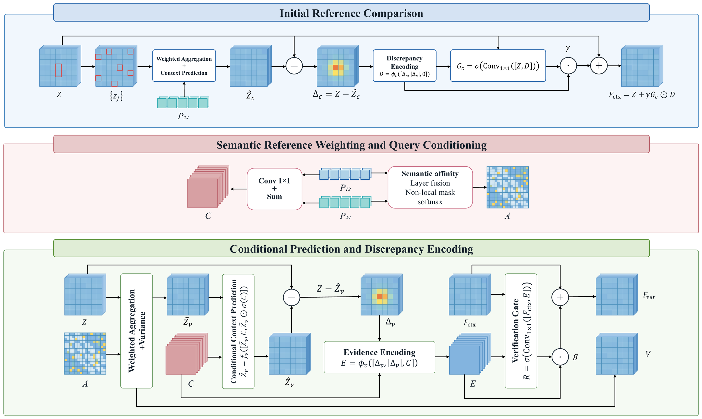
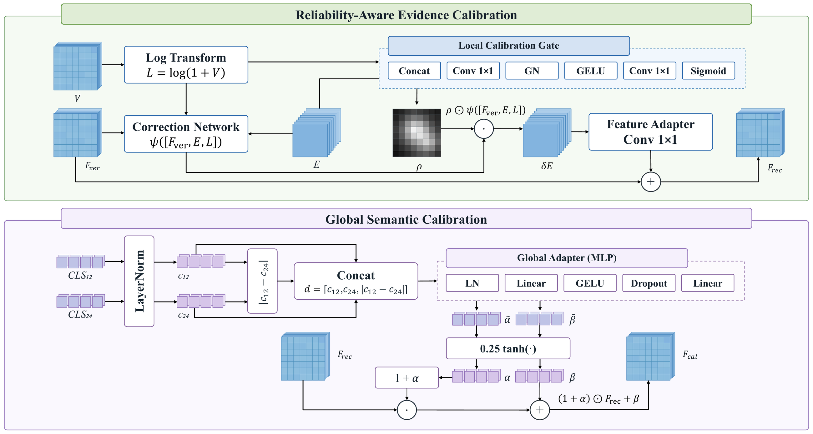
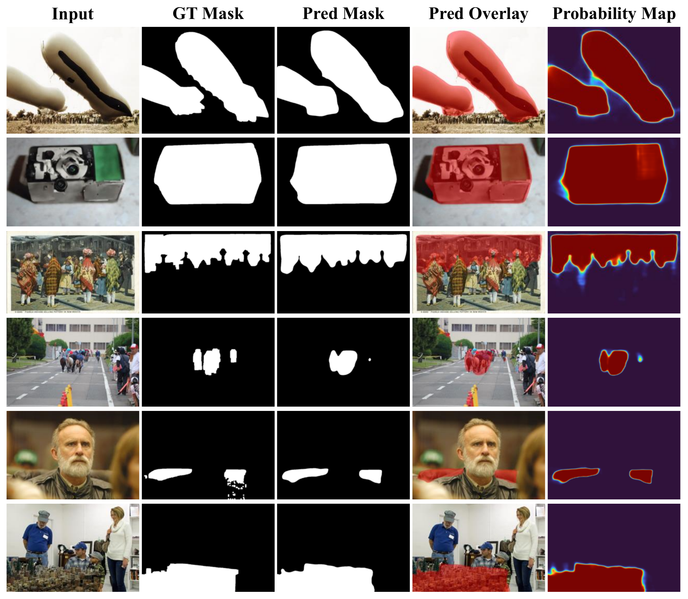
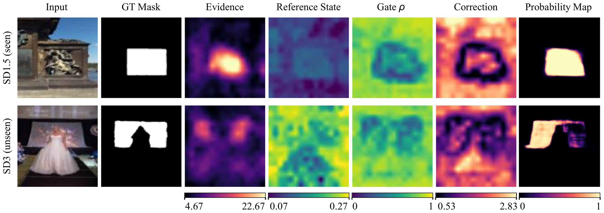
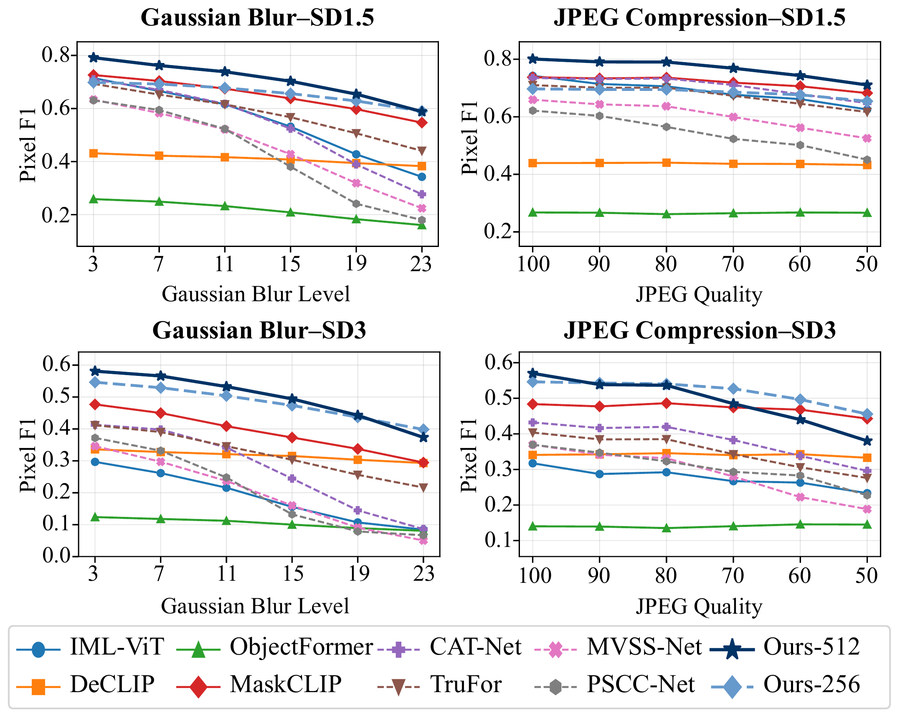

# ReCoCal

**Reference Comparison and Reliability Calibration for Image Forgery Localization**

参考比较与可靠性校准的图像篡改定位。

**Image forgery localization demo · 图像篡改定位演示**

> **Current release: demo. The full version will be released after the paper is accepted.**
>
> **当前版本为 demo。论文录用后将公开完整版。**

[English](#english) · [中文说明](#chinese) · [Paper figures / 论文配图](#figures) · [Weights / 模型权重](https://pan.baidu.com/s/1JAV7ZbY1vyrR0dWVTV7tdw?pwd=6pxg)

This demo provides inference and visualization for the ReCoCal localization model at 256 and 512 input resolutions. It includes the model implementation and a command-line visualization tool. Training code and the complete experimental workflow will accompany the full release after paper acceptance.

本 demo 提供 ReCoCal 模型在 256 和 512 输入分辨率下的推理与可视化功能，包含模型实现和命令行可视化工具。训练代码及完整实验流程将在论文录用后的完整版中公开。



**Figure 1. ReCoCal framework.** A trainable MiT-B2 backbone and a frozen CLIP ViT-L/14 encoder supply visual and semantic representations. SCDV performs intra-image reference comparison and forgery verification, followed by reliability-aware local-global calibration (RLGC) and an F3-assisted progressive decoder. The output is a pixel-level forgery probability map; its maximum provides the image-level score.

**图1：ReCoCal 整体框架。** 可训练的 MiT-B2 主干与冻结的 CLIP ViT-L/14 编码器分别提供视觉和语义表征。SCDV 完成图内参考比较与伪造验证，随后通过可靠性感知的局部-全局校准（RLGC）及 F3 辅助渐进式解码器生成像素级伪造概率图，并以最大概率作为图像级分数。

<a id="english"></a>

## English

### 1. Environment

The demo has been tested with Python **3.12.3**, PyTorch **2.7.1+cu128**, and torchvision **0.22.1+cu128**. Run commands from the repository root in your chosen Python environment.

```bash
python -m pip install -r requirements-torch-cu128.txt
python -m pip install -r requirements.txt
```

For CPU-only use, replace the first command with:

```bash
python -m pip install torch==2.7.1 torchvision==0.22.1 --index-url https://download.pytorch.org/whl/cpu
```

### 2. Download the model weights

Download the **ReCoCal demo weights** (shared folder: `C2Dweights`) from [Baidu Netdisk](https://pan.baidu.com/s/1JAV7ZbY1vyrR0dWVTV7tdw?pwd=6pxg). **Extraction code: `6pxg`.**

Copy the three checkpoints into `weights/`. If the download has an outer `C2Dweights` directory, copy the files inside it into `weights/`; keep the filenames below unchanged.

```text
weights/
├── c2d_256.pth
├── c2d_512.pth
├── clip_visual.pth
└── mit_b2/
    └── config.json
```

`weights/mit_b2/config.json` is included in this repository. The trained student checkpoints already contain the MiT-B2 backbone. All model assets resolve relative to the repository; after dependencies and weights are installed, inference runs offline without the original project, OpenSDI, or an existing Hugging Face cache.

### 3. Run the demo

Check execution with a generated synthetic image:

```bash
python visualize.py --smoke-test --output results/smoke
```

Visualize one image using the 512 model:

```bash
python visualize.py --input "path/to/image.jpg" --resolution 512 --device cuda --output results/image_512
```

Use the 256 model, or process an image directory:

```bash
python visualize.py --input "path/to/image.jpg" --resolution 256 --output results/image_256
python visualize.py --input "path/to/images" --resolution 512 --max-images 10 --output results/folder
```

Include a ground-truth mask when available:

```bash
python visualize.py --input "path/to/image.jpg" --mask "path/to/mask.png" --resolution 512 --output results/with_gt
```

Replace the example paths with your own files. Ground-truth masks are optional. `--mask` also accepts a directory with matching relative paths/stems. Mask values greater than 127 are treated as forged pixels. Use `--device cpu` for CPU execution, or omit `--device` for automatic CUDA/CPU selection. `--no-amp` disables mixed precision; `--threshold` sets the prediction threshold (default: 0.5). `--max-images 0` processes all supplied images. Run `python visualize.py --help` for all options.

### 4. Read the outputs

| Output | Contents |
| --- | --- |
| `localization.png` / `.svg` | Input, optional GT, prediction, overlay, and probability map |
| `mechanism.png` / `.svg` | Input and the F_ctx, F_ver, F_rec, F_cal feature maps |
| `prediction.png`, `overlay.png` | Binary predicted mask and red prediction overlay |
| `probability.png`, `probability.npy` | Probability visualization and float32 probability values |
| `f_ctx.png`, `f_ver.png`, `f_rec.png`, `f_cal.png` | Individual stage response maps |
| `summary.json` | Run settings, relative input names, image scores, and optional per-image metrics |

Figures are written into a separate subdirectory for each image. Probability maps are resized back to the original image dimensions and use a fixed [0,1] color scale. Feature responses use mean absolute channel activation, normalized separately per image/stage. The image score is the maximum sigmoid mask probability at model input resolution. Optional per-image F1/IoU are computed at original image resolution. The synthetic smoke test checks execution and does not measure localization performance.

### 5. Repository contents

```text
ReCoCal/
├── README.md
├── visualize.py
├── config.py
├── models/
├── weights/
│   ├── README.md
│   └── mit_b2/config.json
├── assets/figures/
├── requirements.txt
├── requirements-torch-cu128.txt
├── MODEL_MANIFEST.json
├── THIRD_PARTY.md
└── licenses/
```

Model checkpoints are downloaded separately. The current demo does not include training scripts or the complete experiment suite. The full version will be made public after paper acceptance. Third-party terms are retained in [THIRD_PARTY.md](THIRD_PARTY.md) and `licenses/`; this release does not add a license for project-authored code.

<a id="chinese"></a>

## 中文说明

### 1. 安装环境

demo 已在 Python **3.12.3**、PyTorch **2.7.1+cu128**、torchvision **0.22.1+cu128** 环境中测试。请在所用 Python 环境中进入仓库根目录执行：

```bash
python -m pip install -r requirements-torch-cu128.txt
python -m pip install -r requirements.txt
```

如果只使用 CPU，将第一条命令替换为：

```bash
python -m pip install torch==2.7.1 torchvision==0.22.1 --index-url https://download.pytorch.org/whl/cpu
```

### 2. 下载并放置权重

通过百度网盘下载 **ReCoCal demo 权重**（共享文件夹名为 `C2Dweights`）：[下载链接](https://pan.baidu.com/s/1JAV7ZbY1vyrR0dWVTV7tdw?pwd=6pxg)。**提取码：`6pxg`。**

将三个权重文件放入仓库的 `weights/` 目录。如果解压后的外层文件夹名为 `C2Dweights`，请将其中的权重文件复制到 `weights/`，并保持下面的文件名：

```text
weights/
├── c2d_256.pth
├── c2d_512.pth
├── clip_visual.pth
└── mit_b2/
    └── config.json
```

仓库已经提供 `weights/mit_b2/config.json`。学生模型权重已包含 MiT-B2 主干，推理时无需额外下载其预训练张量。程序按仓库相对路径加载模型；环境和权重准备完成后，推理无需联网，也不依赖原项目、OpenSDI 数据集或已有的 Hugging Face 缓存。

### 3. 运行示例

先使用程序生成的合成图片检查能否正常运行：

```bash
python visualize.py --smoke-test --output results/smoke
```

使用 512 模型处理单张图片：

```bash
python visualize.py --input "path/to/image.jpg" --resolution 512 --device cuda --output results/image_512
```

使用 256 模型，或处理图片文件夹：

```bash
python visualize.py --input "path/to/image.jpg" --resolution 256 --output results/image_256
python visualize.py --input "path/to/images" --resolution 512 --max-images 10 --output results/folder
```

如果有 GT 掩码，可以一并传入：

```bash
python visualize.py --input "path/to/image.jpg" --mask "path/to/mask.png" --resolution 512 --output results/with_gt
```

请将示例路径替换成自己的文件。GT 掩码为可选项；`--mask` 也可指定与输入相对路径/文件名对应的掩码文件夹，大于 127 的掩码值被视为伪造像素。使用 CPU 时传入 `--device cpu`；省略 `--device` 则自动选择 CUDA 或 CPU。`--no-amp` 用于关闭混合精度，`--threshold` 设置二值预测阈值，默认为 0.5。`--max-images 0` 表示处理所有输入图片。全部参数可通过 `python visualize.py --help` 查看。

### 4. 查看结果

| 输出文件 | 内容 |
| --- | --- |
| `localization.png` / `.svg` | 输入图、可选 GT、预测掩码、叠加图及概率图 |
| `mechanism.png` / `.svg` | 输入图及 F_ctx、F_ver、F_rec、F_cal 阶段特征图 |
| `prediction.png`、`overlay.png` | 二值预测掩码和红色预测区域叠加图 |
| `probability.png`、`probability.npy` | 概率可视化及 float32 原始概率值 |
| `f_ctx.png`、`f_ver.png`、`f_rec.png`、`f_cal.png` | 各阶段独立响应图 |
| `summary.json` | 运行参数、相对图片名、图像分数和可选的单图指标 |

每张图片的结果分别保存在独立子目录中。概率图会还原到原图尺寸，并使用固定的 [0,1] 色彩范围。特征图采用通道绝对响应均值，按每张图、每个阶段独立归一化。图像分数为模型输入分辨率下的最大掩码概率；可选的单图 F1/IoU 则在原图分辨率下计算。合成图片测试仅用于检查程序运行情况，不作为定位性能证据。

### 5. 当前发布范围

当前仓库为 **demo 版本**，提供模型实现和推理可视化工具，权重通过独立网盘链接下载。**论文录用后将公开包含训练代码与完整实验流程的完整版。**

本次发布暂不为项目原创代码添加许可证。第三方模型的原有条款继续保留，详见 [THIRD_PARTY.md](THIRD_PARTY.md) 和 `licenses/`。

<a id="figures"></a>

## Paper figures / 论文配图

The following figures retain their paper numbering. They illustrate the method and the supplied paper results; the current demo provides inference/visualization rather than the full experimental workflow.

以下配图保留论文中的原编号，用于展示方法及已有论文结果；当前 demo 提供推理与可视化功能，完整实验流程将在完整版中公开。

### Figure 2 / 图2：SCDV



**Figure 2. Intra-image reference comparison and verification.** Initial reference comparison forms the contextual feature F_ctx. CLIP patch features from layers 12 and 24 provide semantic reference weights and query conditioning. Conditional context prediction then produces verification evidence E and reference variance V, and a verification gate updates the feature to F_ver.

**图2：图内参考比较与验证。** 初始参考比较生成上下文特征 F_ctx；CLIP 第 12、24 层的 patch 特征用于构建语义参考权重与查询条件。条件上下文预测进一步形成验证证据 E 和参考方差 V，并由验证门控更新得到 F_ver。

### Figure 4 / 图4：RLGC



**Figure 4. Reliability-aware local-global calibration.** The local branch combines the verified feature, verification evidence, and log-transformed reference variance to estimate a calibration gate and an evidence correction, producing F_rec. The global branch fuses CLIP layer-12/24 CLS descriptors and their difference to generate bounded scale and bias parameters for F_cal.

**图4：可靠性感知的局部-全局校准。** 局部分支结合验证特征、验证证据与对数变换后的参考方差，估计校准门控和证据修正，得到 F_rec；全局分支融合 CLIP 第 12、24 层的 CLS 描述符及其差异，生成有界的缩放与偏置参数，得到 F_cal。

### Figure 5 / 图5：Localization results / 定位结果



**Figure 5. Qualitative localization examples.** Each row presents an input image, ground-truth mask, predicted mask, prediction overlay, and forgery probability map. Red overlays mark predicted forged regions. The examples show localization outputs for regions with different sizes and spatial layouts.

**图5：定位结果可视化示例。** 每行依次展示输入图像、GT 掩码、预测掩码、预测区域叠加图和伪造概率图。红色叠加区域表示模型预测的伪造区域，用于观察不同区域大小及空间布局下的定位结果。

### Figure 6 / 图6：Calibration mechanism / 校准机制



**Figure 6. RLGC spatial response analysis.** Representative examples from SD1.5 (seen) and SD3 (unseen) are shown with their GT masks, verification evidence, reference state, calibration gate rho, correction magnitude, and final probability maps. The panels visualize the spatial quantities involved in local calibration.

**图6：RLGC 空间响应分析。** 展示 SD1.5（已见）和 SD3（未见）的代表性样例，以及对应的 GT 掩码、验证证据、参考状态、校准门控 rho、修正幅度和最终概率图，用于观察局部校准涉及的空间量。

### Figure 8 / 图8：Robustness / 鲁棒性



**Figure 8. Gaussian blur and JPEG compression results.** Pixel F1 curves are reported on SD1.5 and SD3 under the blur levels and JPEG quality settings shown on the horizontal axes. The curves include the 256/512 ReCoCal variants, labeled Ours-256/Ours-512, and the comparison methods listed in the legend.

**图8：高斯模糊与 JPEG 压缩结果。** 展示 SD1.5 和 SD3 在图中指定模糊等级、JPEG 质量设置下的 Pixel F1 曲线。曲线包含 ReCoCal 的 256/512 版本（图例为 Ours-256、Ours-512）以及图例中列出的对比方法。
